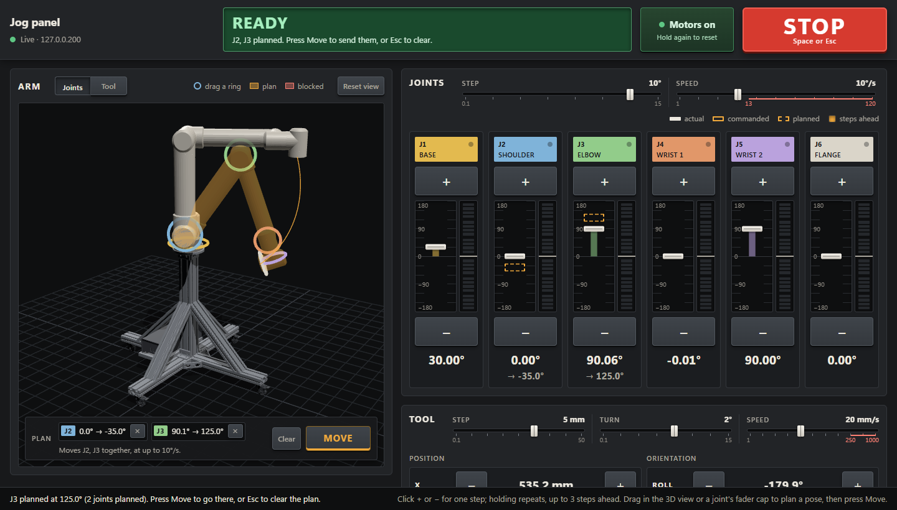

# umbratek-code

Software for an [Umbratek UTRA 6-1000](https://www.umbratek.com/store/robot/utra/utra-6-1000) six-axis arm on its cart: a jog panel in the browser that moves it one exact step at a time or to a pose planned by dragging, programs taught by hand and run under the PC's supervision, a command-line helper, and a simulator and a MuJoCo twin to try it all without the arm.



## Quick start

Without the arm, against the simulator (Python 3.8 or later; the panel and the simulator need only its standard library):

```
git clone --recurse-submodules https://github.com/Inventor22/umbratek-code
cd umbratek-code
python tools/utra_sim.py                 # a stand-in for the arm's controller
python scripts/jog_server.py 127.0.0.1   # in another window; then open http://127.0.0.1:8765
```

With the arm: wire it up and join its network ([docs/connecting.md](docs/connecting.md)), then:

```
python scripts/arm.py find               # find the controller on this PC's networks
python scripts/jog_server.py 192.168.2.1
```

The panel's first start downloads three.js (about 2 MB) for its 3D view and checks it against pinned hashes; after that it works offline. In a clone made without `--recurse-submodules`, `git submodule update --init` fetches Umbratek's SDK.

## What it does

### Jog the joints, or plan a pose by dragging


A click moves a joint exactly one step from where the last click sent it, so quick clicks add up instead of getting lost. Drag a joint's ring in the 3D view and an amber shadow arm shows the pose; nothing moves until Move, which first checks the whole path for collisions with the arm itself, its cart and the floor. More in [the jog panel](docs/jog-panel.md).

### Move the tool with a gizmo


In Tool mode, drag an arrow to slide the tool along X, Y or Z, or a ring to turn it about that axis. The joints follow by inverse kinematics, keeping the arm's elbow and wrist as they are, and Move takes the arm there, turning all its joints together.

### Teach it by hand


Hold for freedrive, guide the arm by hand, and press Record here at each pose: it joins the program as a move. The server runs programs itself, with straight lines, waits, I/O and steps the brain plans, and checks every move before it's sent. More in [programs, teaching and the cell](docs/programs.md).

### Plan around what a camera sees


A planned move asks the brain, a separate process, for its path. Here the brain is the planner (NVIDIA cuRobo, in WSL2), planning on perception's obstacle map from the twin's depth camera: a crate that no keep-out zone or model describes appears, and the next plan goes over it. The jog server checks the brain's path, whole, before anything moves. More in [the brain's README](brain/README.md), whose "Try it" runs this.

## Safety

- Keep the E-stop within reach whenever the motors are enabled.
- Clear the arm's whole reach before running `home` or the notebook demos. They move several joints through large arcs at up to about 30 deg/s.
- `jog` and `home` leave the motors enabled, holding position. Use Umbratek Studio to disable them, or press the E-stop, which cuts power to the arm; after releasing the E-stop, run `reset`.

## More

| Page | What's in it |
| ---- | ------------ |
| [Connecting to the arm](docs/connecting.md) | Wiring, booting and networking the controller; Umbratek Studio |
| [The jog panel](docs/jog-panel.md) | Steps and speeds, the redline, planning a pose, the tool gizmo, collision checks, STOP and the watchdogs |
| [Programs, teaching and the cell](docs/programs.md) | Programs and runs, freedrive, tools, frames, targets and keep-out zones, planned and learned steps, the server's API |
| [Controlling the arm from Python](docs/python.md) | `scripts/arm.py` and Umbratek's SDK |
| [Troubleshooting](docs/troubleshooting.md) | No arm found, E-stop and servo errors, network clashes, a joint past its limit |
| [What's where](docs/repo-layout.md) | Every folder and file in this repo |
| [The brain](brain/README.md) | The stub brain, the twin, perception and the planner, and how to try them |
| [Tests and the simulator](tests/README.md) | The suites, their environments, and `tools/utra_sim.py` |
| [Specification](docs/capabilities.md) and [decisions](docs/decisions.md) | The machine-tending featureset, and why it's built the way it is |
| [The pictures](tools/media/README.md) | How the pictures above are filmed, and how to film them again |

CAD for the mounting plate and gripper, and the UTRA quick start guide, are in [Inventor22/umbratek-cad](https://github.com/Inventor22/umbratek-cad).
