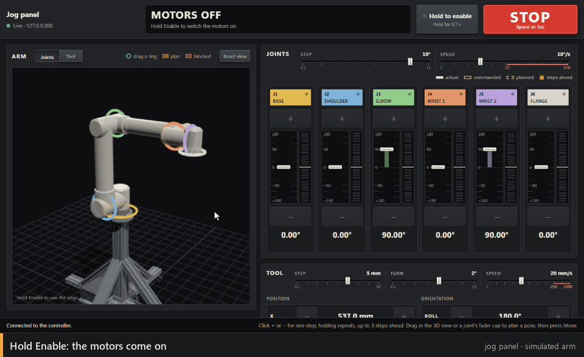
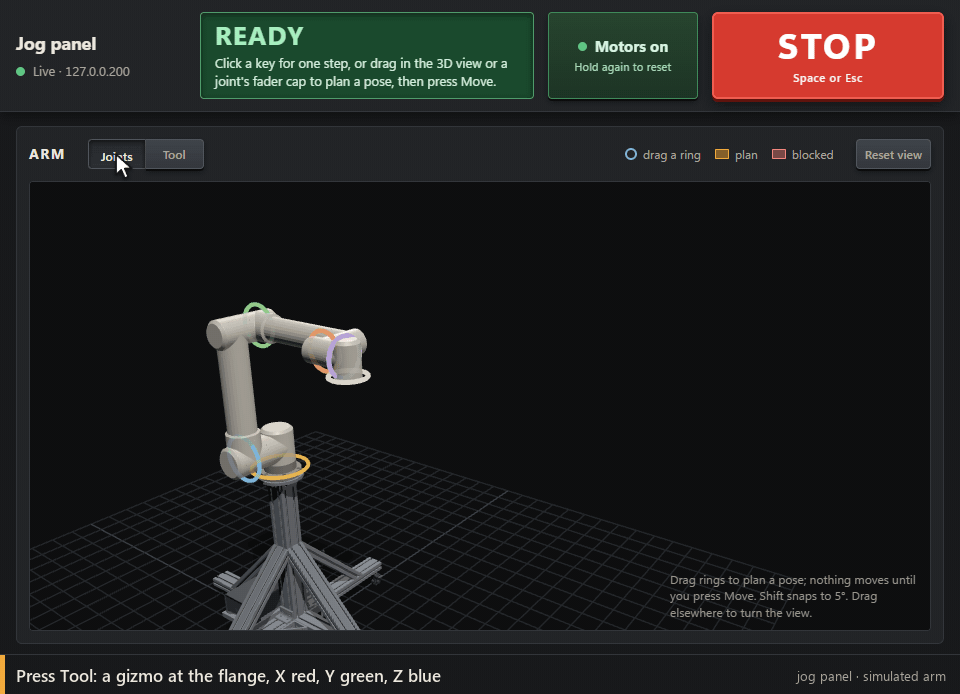

# The jog panel

[Umbratek Studio](connecting.md#using-umbratek-studio)'s Live Control computes each click from the last pose it displayed, so quick clicks can do nothing, and holding a button sends a far-away target that only stops when the release arrives. The jog panel replaces it for manual moves:

```
python scripts/jog_server.py 192.168.2.1
```

Then open http://127.0.0.1:8765 in a browser on this PC.

The first time it starts, the server downloads three.js, which draws the 3D view: about 2 MB from jsDelivr, or from unpkg if jsDelivr can't be reached. So that first start needs internet; after that the panel works offline. It checks the files against hashes pinned in `jog_server.py` every time it starts, and serves only that checked copy, so the page still loads scripts from this PC alone. If the download fails, the panel works without the 3D view, and starting the server again with internet fetches it.



- **Hold Enable** until the green bar fills. It clears a latched error (for example after releasing the E-stop), switches the motors on and makes the arm ready, with the same checks as `scripts/arm.py jog`.
- **3D view:** the arm drawn from Umbratek's URDF and meshes, standing on its cart (from the cart's SolidWorks model) above the floor, following the measured joint angles. Drag empty space to turn the view, right-drag to pan and scroll to zoom; *Reset view* frames the arm and cart again.
- **Planning a pose:** each joint has a coloured ring in the 3D view, matching the tape on its strip. Drag a ring and an amber shadow arm shows the new pose, with the tool's path drawn in; release, and that joint joins the plan. Drag more rings to build up the pose: the rings ride on the shadow, so each drag carries on from the plan. The white cap on each strip's meter works the same way: drag it and drop it on an angle. Hold Shift to snap to 5°; press Esc during a drag to cancel it. Nothing moves yet.



- **Moving the tool instead:** press **Tool** above the 3D view (and **Joints** to go back). A gizmo appears at the flange, coloured as in other 3D tools (X red, Y green, Z blue): drag an arrow to slide the tool along X, Y or Z (the arm's base frame, as on the controller and the tool rows), in 1 mm steps, or 10 mm with Shift. Drag a ring to turn the tool about that axis while the flange stays put, in 0.5° steps, or 5° with Shift. The panel works out the joint angles as you drag (inverse kinematics, from the pose before, so the arm keeps its elbow and wrist the way they are). The shadow arm, the strips and the tool rows show the result, and releasing stages every joint it turns. If the arm can't reach the pose, or a joint would pass its limit, the drag stops at the last pose it can reach and says why. The plan, the collision check and Move work just as they do for rings, and you can mix the two to build a pose. If a staged pose leaves the gizmo near the edge of the view or under the plan bar, the view re-frames to keep it within reach (unless you've turned or zoomed it yourself). Move turns all the joints together, so the tool reaches the planned pose, but it doesn't travel in a straight line on the way; the path is drawn in the view. The panel remembers which mode you used.
- **Move:** the plan bar along the bottom of the 3D view lists the planned joints (× takes one out) and says what Move will do. **Move** sends every planned joint together as one move at the joint speed you've picked; the shadow stays until the arm settles. **Clear**, or Esc, drops the plan without moving. Plans stay within ±180° (±165° for J3), and the panel takes a new plan only once the arm has settled.
- **Collisions are checked before anything moves.** The panel checks the whole path from the arm to the plan, not just the end, against the arm itself, its cart and the floor, and won't move if any part would come within 10 mm of another. The shadow, path and readout turn red, a red mark shows where it first comes too close, the cart part it would hit is outlined in red, and the plan bar names the parts ("the forearm would come within 10 mm of a cart brace"). The server checks every plan again before sending it. The arm's links are covered by capsules fitted to Umbratek's meshes, so the check errs on the cautious side by up to a few centimetres at the motor housings. Whatever is mounted on the flange is modelled only as the shape you give the tool in use (the cell: [programs.md](programs.md)). If the arm already sits within 10 mm of something, it may move away but not closer. A keep-out zone that interlocks guard (a machine's door, say: [programs.md](programs.md)) is open to jogs and Move only while its interlocks hold, read as the step or plan is sent; otherwise the step is refused, saying which interlock doesn't hold, and if one stops holding while the arm moves into the zone, the server stops it. The 3D view's own check follows the interlocks as they were last read, once a second.
- **Joints:** each joint has a strip. **+** and **−** move it one step. Its meter shows the actual angle (solid bar) and, while it moves, the commanded angle (hollow bar). The amber lights beside the meter count how far the command is ahead of the arm, four lights per step up to the three-step limit, and go out as the arm catches up.
- **Tool:** moves the tool in X/Y/Z or turns it in roll/pitch/yaw. With a plan staged, each row shows in grey where the plan would put the tool.
- **Step and speed:** set them on the small faders at the top of each section; each snaps to the values the arm accepts. Joint steps run 0.1–15° at 1–120 °/s; tool steps run 0.1–50 mm, turns 0.1–15°, at 1–1000 mm/s (the UTRA 6-1000's published top speed, and Umbratek Studio's limit). Each joint move is capped at the top speeds of the joints it turns: 84 °/s for J1 and J2, 114.5 °/s for J3 and 119.1 °/s for the wrists. Those are 80% of the limits the joints' own servos report (220 rad/s at the motor through 120:1 gearboxes for J1 and J2, 250 and 260 rad/s through 100:1 for the rest, so 105, 143 and 149 °/s), because the controller faulted with error 24, a speed limit, on a J3 move at 120 °/s. Umbratek's ROS model of the arm claims faster joints (up to 172 °/s) than these servos allow. Set above those caps, the joint speed fader prints which joints top out lower, and the message line says when a move was capped. Moves ramp up to speed in about 0.3 s, but never harder than the maximum acceleration configured in the controller, which the panel prints when it starts. On this arm that's 200 °/s² for the joints and 200 mm/s² for the tool, so short steps never reach the top speeds: a 5° step peaks near 30 °/s, a 15° step near 55 °/s and a 50 mm step near 100 mm/s. The top speeds show on long planned moves. Speed is a deliberate choice: the speed faders go back to 10 °/s and 20 mm/s every time the panel opens (the steps are remembered), and at the top speeds the tool can move faster than a metre a second. Lock the cart's casters.
- **Redline:** like a speedometer, each speed fader turns red past the speeds that could carry the flange faster than 250 mm/s, the limit the ISO 10218 robot safety standard sets for jogging by hand. The red zone prints where it starts ("250", or "17" on joint speed). With the cap in the red the value turns red, and the message line says how fast the flange could go and which joint would take it there. It says so again on every step in the red, and when you leave it. Red speeds still work; the redline is a warning, unless reduced speed is on (below). On tool speed it's fixed at 250 mm/s, a step of its own. On joint speed it follows the arm: it's the slowest speed at which turning one joint alone would swing the flange past 250 mm/s from where the arm is now. That's usually the shoulder, around 25 °/s with the arm folded and 14 °/s stretched out. A staged plan has a line of its own, often lower, because joints that turn together add up; the fader shows whichever is lower, and the plan bar's note turns red with the figure when the plan passes its own. The panel assumes full reach until it knows the pose. Anything mounted on the flange sticks out further, and moves faster.
- **Clicking and holding:** one click moves exactly one step from the last commanded position, so quick clicks add up. Holding a key repeats the step four times a second, and the commanded position never runs more than three steps ahead of the arm, so a hold covers about four steps a second whatever the speed: pick a bigger step to cover more ground. Joint steps get the same collision check, one step at a time. Tool steps are planned as the straight line the controller will drive and checked the same way, with the tool in use and the keep-out zones; a step out of reach or through a wrist singularity is refused before it's sent.
- **STOP** or Space stops the arm and clears queued moves (and any program run, and freedrive); so does Esc, once there's no drag or plan to back out of (and always while the arm moves). Space types a space while you're typing in a text field; STOP and Esc still stop. Hold Enable to carry on.
- **Reduced speed** (for teaching; `--reduced-speed`, or `POST /api/manual` below): nothing the server sends can move the tool point or the flange faster than 250 mm/s, the redline. Rather than refuse, it lowers the speed of each jog step, planned move, move to a target and program step, a program marked `"fullSpeed": true` included, and the message line says so. For a joint move it takes how far the tool point and the flange are from each turning joint's axis along the way, joints turning together adding up (a J2 step from the start pose goes at 16.6 °/s). For a tool step or a straight line, the controller drives the flange at the speed sent, and a turn swings a tool point off the flange, so a turn is slowed by how far out the tool point is (a 5° turn of a 200 mm tool goes at 31 mm/s). Freedrive is untouched: the hand moves the arm. As with the redline, only the tool point and the flange's centre count; anything sticking out further moves faster.
- **Hold-to-move** (for teaching; `--hold-to-move`, or `POST /api/manual`): an enabling device. Nothing moves without a current hold, which the device that turned it on renews about every 0.1 s while its hold-to-move key is down (`POST /api/hold`). Without one, jogs, planned moves, moves to targets and starting, resuming or stepping a run are refused, saying why. Let go of the key, or lose the link, while the arm moves, and the server stops it within 0.1 s, as STOP does; a program's run pauses instead, and holding the key again and pressing Resume carries on. Enable, STOP, freedrive, dry runs and the cell work without a hold. The bridge shows reduced speed and hold-to-move under the link light, the lamp amber while the key is held. This page has no hold-to-move key of its own, so while it isn't held the state window says moves need it held on the device that asked for it. Neither setting can change while the arm moves.

Over Wi-Fi the controller's status stream stalls for about 3 seconds every half minute (33 s on 2026-10-21; a cable to your router avoids it). The panel rides this out: the link light turns grey and shows how old the status is, a click waits for fresh status before it's sent, and NO SIGNAL appears only after 5 seconds of silence.

The panel stops the arm if the page stops talking to it mid-move (a closed tab or a sleeping PC), if the controller's status stays quiet for more than 4.5 seconds, or if the controller reports an error. It listens on this PC only and ignores requests from other web pages. Keep the hardware E-stop within reach; it's still the real safety.

The controller serves one command connection (port 502) at a time and closes any other at once. While the jog panel runs it holds that connection, so its STOP goes over it, and `scripts/arm.py` (including `arm.py stop`) and the notebook can't connect until you quit the panel.

Another program on this PC can start the jog panel and drive it through its API, as the owner's modes app does. It sets `UMBRATEK_PANEL_TOKEN` in the server's environment: at least 16 characters of URL-safe base64 (`A-Z`, `a-z`, `0-9`, `-` and `_`, without padding, as Python's `secrets.token_urlsafe` writes it). The page and every POST then carry that token, in the `X-Panel-Token` header, instead of a random one; the server won't start with a token that's too short or has other characters in it, and never prints it. Requests still go to `127.0.0.1` on the panel's port. `GET /api/status` says whether the controller is the simulator or the twin (`"simulated": true` for an address of this PC's own: 127.0.0.0/8, ::1, or localhost) and reports the policy, `"manual": {"reducedSpeed", "holdToMove", "held", "holdLeftMs"}`. `POST /api/manual {"reducedSpeed": true, "holdToMove": true}` sets it (either may be left out), and `POST /api/hold {"ms": 400}` holds for that many milliseconds from now (100 to 1000; 400 if left out), `{"ms": 0}` letting go.

The panel's Program, Teach and Cell sections are in [programs.md](programs.md).
