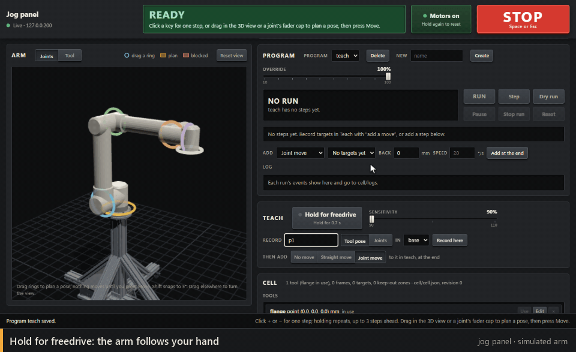

# Programs, teaching and the cell

Below the joints and the tool, the [jog panel](jog-panel.md) has three more sections for machine-tending work: **Program**, **Teach** and **Cell**. The server keeps everything in a folder (`cell/` in the repo, which git ignores; pick another with `--cell DIR`) and runs programs itself, so a run carries on with the page closed and is supervised by the server, not the page. `docs/capabilities.md` specifies the featureset and `docs/decisions.md` records why it works the way it does.

- **The cell** (`cell/cell.json`): *tools*, *frames*, *targets* and *keep-out zones*. Every change is saved at once with a new revision; a page holding an older revision is refused rather than overwriting someone else's change.
  - A **tool** is its tool point (mm from the flange), its payload (kg, and centre of gravity in mm) and its shape: a capsule from the flange towards the tool point, which joins the collision check. **Use** makes it the tool in use and sends its payload to the controller. The controller's own tool offset stays zero: the panel applies the tool point itself (`docs/decisions.md`, D14). To find a tool point you can't measure, name the tool, rest its point on one fixed spike from four or more well-turned angles and press **Touch** at each, then **Fit**: the panel solves for the point and reports how well the touches agree (RMS).
  - A **frame** is a fixture's position and orientation (in the base, or in another frame). Name it, touch its origin, a point along its +X edge and a point on its +Y side with the tool point, then **Fit**. Targets and zones are stored in their frame, so recalibrating a frame after moving the fixture moves every target in it: the message says how many moved, and flags any now out of reach or in another arm configuration.
  - A **target** is a tool-point pose in a frame (with the tool and the joint angles it was taught with, which keep the arm's elbow and wrist the way they were), or plain joint angles. **Plan** beside a target stages a joint move to it, just as dragging does: the shadow arm and the plan bar show it, and nothing moves until you press **Move**. Straight moves to targets run as program steps (**Step** runs one at a time).
  - A **keep-out zone** is a box in a frame: no part of the arm or tool may come within 10 mm of it. The 3D view draws zones as faint boxes, frames as a short light line along their x axis with their name, and targets as dots.
- **Programs** (`cell/programs/<name>.json`) are lists of steps: joint and straight moves to targets (optionally backed off along the tool, at their own speed), planned moves and learned skills (below), waits (for a time, or for an input with a timeout), setting or pulsing an output, halts (pause with a message for the operator) and comments. Repeats, ifs and calls to other programs are written in the JSON (see `scripts/runner.py`) and shown in the list; the page edits the top level and repeats. Click a step to select it: new steps and recorded targets go after it. A target used by a program can't be deleted.

- **The brain: planned moves and learned skills.** A *planned move* goes to a target along a path the brain plans afresh each run, around what's in the cell (its keep-out zones and the tool), ending in the configuration the target was taught in. A *learned skill* handles the variable part of a job: the brain's skill acts in short bursts, at most ten a second, keeping the tool point within a set distance of a target, until it says it's done; then an input can be checked (written in the JSON, `"check"`). The brain is a separate process on this PC, which the server asks (`--brain`, by default `http://127.0.0.1:8770`; it may run in WSL2). Until the real one exists, start the stub: `python brain/stub/stub_brain.py`. The brain only proposes: the server checks everything it proposes, whole, before anything moves (limits, collisions with the arm, cart, floor, tool and zones, speeds, and that the arm is still where the brain was told it was), and refuses it with its reasons otherwise, which faults the run. Those steps carry a grey cue naming the brain's part, or a red one when the brain isn't answering or lacks the skill, and a run that needs the brain won't start without it. STOP stops them as anything else, even while the brain is thinking. `docs/brain-interface.md` specifies the interface.
- **Running:** **Run** runs from the top, **Run from** on a step runs from there, **Step** runs one step and waits, **Dry run** plans every move and checks it for collisions without moving anything or setting outputs (a wait for an input assumes it arrives; an if reads the input as it is; a planned move asks the brain for its path; a learned skill is assumed to end where it began) and says how long the run would take. **Pause** stops the arm; **Resume** re-plans the interrupted step from wherever the arm is, first moving back onto the straight line it was on, if it was on one. **Stop run** ends it. A step that can't be done (out of reach, blocked, the arm knocked off its path, an input that never came, a controller error) stops the arm and *faults* the run; when a move would have collided, the 3D view shows where, as it does for a blocked plan. Fix the cause and press **Reset**. Every move is planned and collision-checked before it's sent, and watched against its plan while it runs. Programs run at their own speeds (by default 50 mm/s for lines, 20 °/s for joint moves) times the **Override** (10 to 100%); straight lines, and whatever the brain proposes, are capped at 250 mm/s at the tool unless the program's JSON says `"fullSpeed": true`. Jogging is refused while a program moves the arm and allowed while it's paused.
- **The log:** the Program section lists the run's events; every run is also written to `cell/logs/<date>/<time>-<program>.jsonl` (`~2`, `~3` added before `.jsonl` for another run of the same program started in the same second).

- **Teaching:** hold **Hold for freedrive** until the amber bar fills, guide the arm by hand, and press **Record here** at each pose: as a tool pose in the chosen frame or as joint angles, and with **Then add** set to a straight or joint move, a move to it is added to the program after the selected step. Freedrive starts only from READY. Press the key again to leave: the controller switches the motors off onto their brakes (the arm settles about half a millimetre; recorded targets are from before that), and the panel switches them back on with Enable's checks. STOP in freedrive holds the arm rigid, then switches the motors off; freedrive also ends on its own after 10 minutes, motors off. **Sensitivity** is the controller's teach sensitivity, 90, 100 or 110 % (set it before entering; writing it stops the arm). On this arm 90, the default, stops where you let go; 100 and 110 make the shoulder and elbow lighter, but a raised elbow sinks back a few degrees. Don't turn a joint by hand past about ±350 degrees: the controller faults at its limit (see [troubleshooting](troubleshooting.md)).

What the 10 Hz status allows, and what it rules out (no stopping on contact, for one), is in `docs/capabilities.md`.

The server's API (JSON; every POST needs the page's token, so only the page can call it): `GET /api/cell`, `/api/programs`, `/api/program?name=`, `/api/run`, `/api/io`; `POST /api/cell/tool`, `/api/cell/tool/activate`, `/api/cell/tool/delete`, `/api/cell/tool/touch`, `/api/cell/tool/touch/clear`, `/api/cell/tool/calibrate`, `/api/cell/frame`, `/api/cell/frame/delete`, `/api/cell/frame/touch`, `/api/cell/frame/calibrate`, `/api/cell/target`, `/api/cell/target/delete`, `/api/cell/zone`, `/api/cell/zone/delete`, `/api/program`, `/api/program/delete`, `/api/run/start`, `/api/run/pause`, `/api/run/resume`, `/api/run/step`, `/api/run/stop`, `/api/run/reset`, `/api/run/override`, `/api/moveto`, `/api/plan`, `/api/io/set` and `/api/freedrive`. `scripts/jog_server.py` (`api_get`, `api_post`) documents their bodies.
